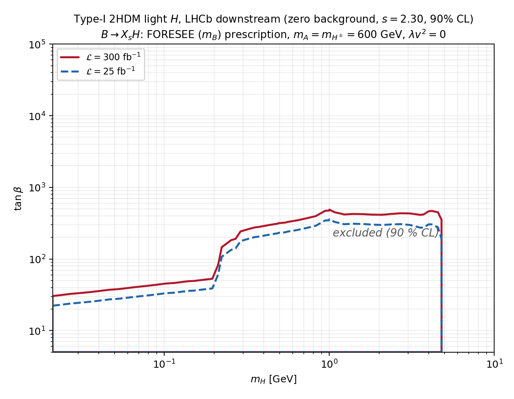

# LLP-AGI — 长寿命轻标量在 LHCb Downstream 的灵敏度

本仓库是两次端到端的粒子物理灵敏度研究：用 ColliderAgent 风格的 agent 流水线 + Magnus 作业
后端，从 Pythia 母样本、模型的产生/衰变计算、LHCb Downstream 探测器响应，一路算到 90% CL 的
排除曲线。两次运行共用同一套探测器内核与事例级统计，但模型、产生道和衰变程序不同。

| 分析 | 模型/基准 | 参数空间 | 结果 | 目录 |
|---|---|---|---|---|
| **BC5 暗标量** | Higgs 混合单态实标量 `S`，`BR(h→SS)=0.01`（PBC BC5） | (m_S, θ²) | v3.6 验收基线：排除曲线 + 完整自检 | [`runs/bc5_lhcb_downstream_v3/`](runs/bc5_lhcb_downstream_v3/) |
| **Type-I 2HDM 轻 H** | CP-even `H`，`m_h=125`、`m_A=m_H±=600`、`λv²=0`、`cos(β−α)=1/tanβ` | (m_H, tanβ) | 2026-10-27 最终版：长寿边 22–358 / 30–489 | [`runs/20261025_1325_UTC_2HDM_lightH_lhcb_downstream/`](runs/20261025_1325_UTC_2HDM_lightH_lhcb_downstream/) |

两次运行为 pp √s = 13 TeV、LHCb Downstream（1 < z_dec < 2.5 m、2 < η < 5、反向双径迹
E > 5 GeV / pT > 0.5 GeV、ε_rec = 0.4、零背景零观测 s₉₀ = −ln 0.1 = 2.3026）、
L = 25 与 300 fb⁻¹。全部结果都是"该假设下的**预期**灵敏度"，不含真实背景与探测器系统误差。

## 主结果：Type-I 2HDM 轻 H



长寿边（tanβ 排除上限；m_H > 4.786 GeV 后 `B→X_sH` 运动学关闭）：

| m_H [GeV] | 25 fb⁻¹ | 300 fb⁻¹ | | m_H [GeV] | 25 fb⁻¹ | 300 fb⁻¹ |
|---|---|---|---|---|---|---|
| 0.021 | 22.2 | 30.3 | | 1.000 | **358** | **489** |
| 0.195 | 38.8 | 52.9 | | 2.072 | 299 | 414 |
| 0.290 | 178 | 243 | | 3.501 | 276 | 415 |
| 0.494 | 232 | 316 | | 4.180 | 304 | 469 |
| 0.827 | 291 | 397 | | 4.784 | 190 | 353 |

要点：

* 长寿边统计误差 3.6% 中位、最大 4.3%/4.8%（≤5% 目标）；边界位置误差中位 0.5%。
* **低 tanβ 侧没有被本分析闭合**：修正后的估计量给出 s(tanβ=5…10) 比阈值大 10³–10⁶ 倍，
  整个扫描范围（tanβ ≥ 5）一直处于排除区；主图的下边界因此是扫描下界，而不是物理交点。
  低 tanβ 深处 `BR(B→X_sH) ≳ 0.1`，属 EFT 失效区（CSV 有 validity 标记）。
* `B→X_sH` 处方：名义用 **FORESEE（m_B 相空间）**，另给 `paper_mb`（论文印刷公式，m_b=4.18）
  与 `exclusive`（Boiarska 逐道）两个变体。

## 主结果：BC5 暗标量

θ² 的排除边界（25 fb⁻¹；长寿边 = 物理上限）：

| m_S [GeV] | θ² 长寿边 | θ² 短寿边 | | m_S [GeV] | θ² 长寿边 | θ² 短寿边 |
|---|---|---|---|---|---|---|
| 0.021 | 7.1×10⁻⁶ | — | | 0.566 | 4.2×10⁻¹⁰ | 9.0×10⁻⁵ |
| 0.138 | 1.1×10⁻⁶ | — | | 1.000 | 4.8×10⁻¹¹ | 2.1×10⁻⁶ |
| 0.280 | 3.2×10⁻⁹ | — | | 2.000 | 1.4×10⁻¹⁰ | 5.9×10⁻⁶ |

细节、变体与自检见 [`runs/bc5_lhcb_downstream_v3/`](runs/bc5_lhcb_downstream_v3/)（v3.6 验收记录
[`logs/v36_acceptance.md`](runs/bc5_lhcb_downstream_v3/logs/v36_acceptance.md)）。

## 仓库结构

| 路径 | 内容 |
|---|---|
| [`detector/downstream/`](detector/downstream/) | Downstream 探测器卡、C++ 传播内核（磁场 + 几何 + 选择）与测试 |
| [`configs/`](configs/) | 环境锁（`container_deployment.lock.json`） |
| [`docs/`](docs/) | 部署与 Downstream 导入说明 |
| [`phenomenology/darkscalar/`](phenomenology/darkscalar/) | BC5 模型输入表与预处理程序 |
| [`runs/`](runs/) | **每次运行一个目录**：输入快照、代码、日志、输出；索引见 [`runs/README.md`](runs/README.md) |
| [`prompt.md`](prompt.md) / [`prompt_2HDM.md`](prompt_2HDM.md) | 两次运行的任务书（物理设定、验收标准） |
| `temp/` | 临时脚本（不跟踪） |

每个 run 目录的结构一致：`inputs/`（带 sha256 的输入快照）、`work/`（各阶段程序）、
`logs/`（报告/审查/验证）、`outputs/`（`data/` CSV/JSON + `figures/` 图）、
`README.md`（结果与复现）、`RUNNING.md`（怎么跑）。

## 复现

环境：Windows x64（`downstream_kernel.dll` 为预编译内核）、Python 3.11+（numpy + matplotlib）、
可选 g++（重建作者衰变程序）。两份 run 的详细步骤如下：

* 2HDM：[`runs/20261025_1325_UTC_2HDM_lightH_lhcb_downstream/RUNNING.md`](runs/20261025_1325_UTC_2HDM_lightH_lhcb_downstream/RUNNING.md)
* BC5：[`runs/bc5_lhcb_downstream_v3/RUNNING.md`](runs/bc5_lhcb_downstream_v3/RUNNING.md)

最短自检（不重跑扫描，从已提交的聚合结果重算边界并重画图）：

```bash
cd runs/20261025_1325_UTC_2HDM_lightH_lhcb_downstream
python work/analysis/final_analysis.py     # 边界/交点表 + 系统误差图
python work/analysis/final_figure.py       # 主图
python work/analysis/signal_map.py         # 显著度图
python work/analysis/make_manifest.py      # sha256 清单
```

## 数据与第三方材料

| 内容 | 状态 |
|---|---|
| Pythia 母样本（`work/magnus/samples/*.txt.gz`） | **随仓库提供**（每个 run 一份，便于独立重跑） |
| 强子化库（`work/magnus/hadron_lib/*.txt.gz` + manifest） | **随仓库提供** |
| 2HDM 的 500k 事例 pi/K minbias 样本（`minbias_pik.txt.gz`，525 MB） | **以 Release 资产发布**（超过 GitHub 单文件 100 MB 限制），见下 |
| 响应表缓存（`work/analysis/cache/`）与逐质量扫描 JSON | 不入库，由代码 + 样本自动重建（聚合结果 `outputs/data/signal_scan.json` 已入库） |
| `references/`（论文 PDF/LaTeX、FORESEE 工具、作者源码包） | **随仓库提供**，按各自许可使用 |
| `deployment/sources/`（ColliderAgent、Magnus 源码） | 不入库，见其上游仓库（均为公开项目） |

下载 2HDM 的 minbias 样本（唯一不在 git 内的样本）：

```bash
cd runs/20261025_1325_UTC_2HDM_lightH_lhcb_downstream/work/magnus/samples
gh release download samples-2026-10 -R No-thanks-237/LLP-AGI -p minbias_pik.txt.gz -D .
sha256sum minbias_pik.txt.gz
# 期望 cc157eeef958d747da47df6c6e524b26de9eadeeeb73875678ff5cff8a9de41f
# 或者直接在 https://github.com/No-thanks-237/LLP-AGI/releases/tag/samples-2026-10 下载，
# 放到上面这个目录即可（文件名 minbias_pik.txt.gz）。
```

不下载也可以：按 `logs/samples.md` / `logs/magnus_jobs.md` 记录的 Magnus 作业 ID 用
`work/magnus/` 里的脚本重新生成（需要 Docker + Pythia 8.316 容器）。

模型论文与公式来源：arXiv:2212.06186（light scalars / 2HDM 产生公式）、arXiv:1809.01876
（Winkler 宽度）、arXiv:1904.10447（Boiarska 产生率）、arXiv:2105.07077 / 2305.13383（LHCb Downstream）。

## 方法要点

* **不用 FeynRules/UFO/MG5**：模型产生用解析公式（论文附录公式逐条对照），衰变用作者原版
  `Light_scalar_decay` C++ 程序（仅批处理驱动补丁），探测器响应用 BC5 的 Downstream 传播内核。
* **统计**：事例级 OR（同一碰撞内多母粒子/多历史合并）、母粒子按 |pz| 分层 + Horvitz–Thompson
  权重、母粒子衰变位置解析积分（Rao–Blackwell 化，去掉稀有顶点抽样的巨大方差）、
  0.4 重建效率只乘一次。
* **可追溯**：输入带 sha256；`outputs/sha256_manifest.txt` 可用 `sha256sum -c` 完整校验；
  响应表缓存与逐质量结果带完整配置指纹，改代码/样本会自动重建。

## 文档索引

| 文档 | 内容 |
|---|---|
| [`runs/20261025_1325_UTC_2HDM_lightH_lhcb_downstream/README.md`](runs/20261025_1325_UTC_2HDM_lightH_lhcb_downstream/README.md) | 2HDM 运行：模型、产生、衰变、探测器、结果、限制 |
| [`runs/20261025_1325_UTC_2HDM_lightH_lhcb_downstream/logs/physics_code_review.md`](runs/20261025_1325_UTC_2HDM_lightH_lhcb_downstream/logs/physics_code_review.md) | 2HDM 全流程审查（含第三方独立审计逐项处置） |
| [`runs/bc5_lhcb_downstream_v3/logs/v36_acceptance.md`](runs/bc5_lhcb_downstream_v3/logs/v36_acceptance.md) | BC5 v3.6 验收记录 |
| [`runs/bc5_lhcb_downstream_v3/logs/run_report.md`](runs/bc5_lhcb_downstream_v3/logs/run_report.md) | BC5 物理报告 |
| [`docs/downstream_import.md`](docs/downstream_import.md) | Downstream 探测器导入说明 |
