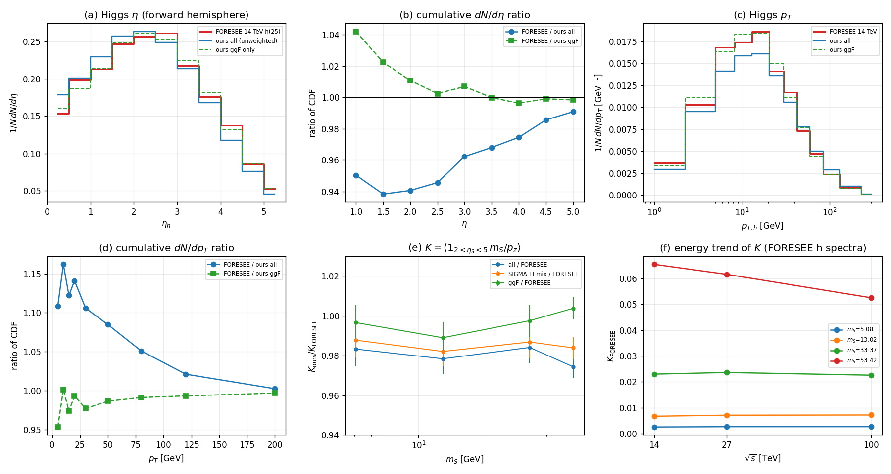

# FORESEE cross-check of our h(125) parent spectrum (task-5)

Scope: does our Higgs parent sample (`runs/bc5_lhcb_downstream_v3/work/magnus/samples/higgs.txt.gz`,
|status|==62) have the right p_T / \eta spectrum for the long-lived-boundary coefficient
K = < 1_{2<\eta_S<5} m_S/p_z > of h -> S S?  Compared with FORESEE (Kling & Trojanowski),
cloned to `temp/foresee/`.

Everything below was produced by the scripts in this directory and re-derived from the files;
no production code or sample was modified.

---

## 0. Verdict (bottom line up front)

| question | answer | evidence |
|---|---|---|
| Are FORESEE's 14 TeV Higgs spectra in the repo? | **YES** — `temp/foresee/files/hadrons/14TeV/Pythia8/Pythia8_14TeV_25.txt` (21 000 grid points, PID 25, 843 889 B). No separate data release is needed. | §1 |
| Is there a Higgs spectrum at *our* energy (13 or 13.6 TeV)? | **NO.** Only 14, 27 and 100 TeV Pythia8 Higgs files exist. Our sample is generated at **13 TeV**, so the comparison is 13 vs 14 TeV. | §1.4, §2.2 |
| Is our Higgs p_T / \eta spectrum right? | **YES at generator level.** Splitting our sample by subprocess, the **ggF component** matches the FORESEE Pythia8 h(25) spectrum to **<=1-2 %** in the dN/d\eta CDF and **<=2.5 %** in the dN/dp_T CDF. The full unweighted sample is 3-6 % more central / 5-16 % softer than FORESEE *because* it contains 20 % non-ggF Higgs (VBF, WH, ZH, bbH, ttH), while the FORESEE file behaves like a ggF-only sample. | §4.2-4.4 |
| Decisive quantity K (per scalar) | K_ours/K_FORESEE = **0.983 +- 0.009, 0.978 +- 0.008, 0.984 +- 0.008, 0.974 +- 0.006** at m_S = 5.08, 13.02, 33.37, 53.42 GeV (full unweighted sample). With the production SIGMA_H mixture reweighting (run_scan.py:501-509): **0.988, 0.982, 0.987, 0.984**. ggF-only: **0.997, 0.989, 0.998, 1.004**. | §4.1 |
| How big is the 13 vs 14 TeV bias? | **<= 0.7 %** on K (estimated from the 14->27 TeV FORESEE trend, §4.5); it does not change the verdict. | §4.5 |
| Does FORESEE have an LHCb-downstream detector? | **NO.** It models far-forward spectrometers at z ~ 100-600 m (FASER/FASER2/...), a fixed-distance decay volume and a transverse selection, with efficiency default 1. There is no 1<z<2.5 m, 2<\eta<5, \epsilon=0.4 card to compare against. | §5 |

Consequence for the analysis: a 2 % change of K moves the long-lived \theta^2 boundary by ~2 %
(and the coupling limit by ~1 %), i.e. **below the other production systematics**.

---

## 1. What FORESEE ships

### 1.1 clone

    git clone --depth 1 https://github.com/KlingFelix/FORESEE.git temp/foresee
    # commit 2d6431f  2025-11-17  "Merge branch 'MCP' into updates"   (git describe: v1.5.0)
    # size 1.8 GB, MIT licence (temp/foresee/LICENSE.md)

The hadron spectra are **inside the git tree** (`temp/foresee/files/hadrons/`, 4 energies x
8 generators); there is no separate large data download and no README pointer to one
(`temp/foresee/README.md` is 28 lines). So nothing had to be downloaded beyond the clone.

### 1.2 The Higgs spectrum file (the decisive file)

`temp/foresee/files/hadrons/14TeV/Pythia8/Pythia8_14TeV_25.txt` (843 889 B, 4 header + 21 000 data lines):

| line | content |
|---|---|
| 1 | "# This file contains the cross section for particles into the FORWARD hemisphere only" |
| 2 | "# Normalization: 14.733956482229985 pb" |
| 3 | "# PID: 25" |
| 4 | # log10(theta) , log10(p/GeV) , cross-section[pb/bin] |

Measured from the file (`inspect_foresee_spec.py`, `inspect_spec2.py`):

* rectangular grid **150 (log10 theta) x 140 (log10 p)**, uniform **0.05 dex** in both,
  log10 theta in [-7.275, 0.175] (theta = 1.19e-5 ... 1.496 rad), log10 p in [-1.975, 4.975]
  (p = 0.0106 ... 94 400 GeV);
* **4006 populated cells** (`w > 1e-6`, the same cut FORESEE applies when reading,
  `src/foresee.py:274`); smallest weight 2.9269e-6 pb, largest 2.4630e-2 pb;
* **sum of all cell weights = 14.733956 pb = the header number exactly** — the third column is
  the bin-integrated cross section, not a density;
* populated \eta range 0.075 ... 12.03 (forward hemisphere; \eta = 0 ... 0.075 is missing because
  the grid stops at theta = 1.496 rad = 85.7 deg, ~1 % of the forward cross section).

### 1.3 Format and provenance

The format and the "forward hemisphere only, pb/bin" convention are documented in the FORESEE
paper, arXiv:2105.07077, section II (https://arxiv.org/abs/2105.07077): *"The meson spectrum is
provided in tables with the consecutive columns corresponding to the bin position in
(log10 \theta_M, log10(p_M/GeV)) and the weights of each bin (3rd column) in units of pb/bin ...
The production cross section is given for the forward hemisphere only."* The same section states
that for the heavier SM species the spectra use **Pythia 8 with the Monash tune**.

How FORESEE itself consumes the file (so that our treatment is identical) —
`temp/foresee/src/foresee.py`:

* `:120-139` `readfile()` — skips `#` lines (`:136`), returns the three columns;
* `:242-300` `convert_list_to_momenta()` — for every populated cell: p = 10**logp,
  th = 10**logth (`:275-276`), one uniform azimuth phi (`:283`), and a **uniform-in-log
  smearing inside the cell** fth = 10**U(-0.025,0.025), fp = 10**U(-0.025,0.025) (`:284-288`).
  Our FORESEE sampling reproduces exactly this (4x4 deterministic sub-nodes in the cell plus a
  uniform phi, §3.3).

### 1.4 What is missing

* **No Higgs spectrum at 13 TeV or 13.6 TeV.** At 14 TeV only the `Pythia8` generator has a
  pid-25 file (the other 14 TeV generators — NLO-P8, NLO-P8-Max/Min, EPOSLHC, QGSJET, SIBYLL,
  SIBYLL2.3c — have hadron spectra but no 23/24/25). `files/hadrons/13.6TeV/Pythia8/` has 25
  files and **none is _25**. So a same-energy comparison is impossible with this release; the
  nearest available Higgs spectrum is 14 TeV (27 and 100 TeV also exist).
* **No LHCb-downstream detector.** See §5.
* The h file's **absolute normalisation must not be used as a rate**: 14.73 pb in the forward
  hemisphere (+ ~1 % for the missing sliver) is ~29.9 pb full solid angle, which is LO-like
  (a LO ggF Pythia8 sample) and far below the NLO/PDG total sigma(pp->h) ~ 55-62 pb at 14 TeV.
  This is also further evidence that the file is **ggF-only** (the ggF-only LO forward cross
  section is ~15-17 pb, the all-process LO one ~20 pb). Only the **shape** is used below.

---

## 2. Our sample

### 2.1 File and selection

`runs/bc5_lhcb_downstream_v3/work/magnus/samples/higgs.txt.gz` read with
`run_scan.load_sample('higgs.txt.gz')` (`work/analysis/run_scan.py:190-231`).

| property | value |
|---|---|
| rows | 1 411 171 |
| unique event ids | 200 000 (0 ... 199 999) |
| rows with \|status\|==62 | **200 000 — exactly one per event** |
| status codes present | -44: 1 011 171, -23: 200 000, 62: 200 000 |
| 2nd column (Pythia process code) | 901-909 (see 2.3) |
| header | # event code px py pz E x y z t status |

The status-62 selection is the production one (`run_scan.py:474-483`). It is the correct
"last pre-decay copy": its p_T agrees with the last -44 shower copy event by event
(max |dp_T| = 6.3 GeV over 199 815 events with both, <p_T> 59.63 vs 59.60, script
`check_status.py`). The first record row of every event is the **-23 hard-process copy**
(<p_T> = 15.70 GeV, p_T = 0 in 82.6 % of events, exactly the ggF 2->1 events) — that would be
the wrong object to use.

### 2.2 Generator settings — our sample is 13 TeV, not 14 TeV

`runs/bc5_lhcb_downstream_v3/work/magnus/bundles_stage_higgs2/parents.cc`
(every other copy in the run has the same value, checked with grep):

* `:29`  **`Beams:eCM = 13000.`**   <- 13 TeV
* `:53`  `HiggsSM:all = on`
* `:54`  `25:mayDecay = off`
* `:55`  `25:m0 = 125.25`
* `:56`  `25:mWidth = 0.0041`
* `:89`  writes the Higgs only if `|eta| < 6.0`
* `:75-78` the 11th column written is the Pythia status

Measured from the sample: <m_H> = 125.24994 GeV (median 125.2500, range 125.045-125.455 — the
4.1 MeV Breit-Wigner), <p_T> = 59.63 GeV, <|eta|> = 2.394.

This is the single most important caveat of the whole comparison: the task compares our
**13 TeV** sample with FORESEE's **14 TeV** spectrum. §4.5 quantifies the bias.

### 2.3 Process composition (why the full sample and the ggF subset differ)

Pythia process code -> group via `work/analysis/bc5_production.py:521-522`; counts of the
200 000 status-62 rows:

| group | sample count | sample fraction | SIGMA_H target (bc5_production.py:509-513) |
|---|---|---|---|
| ggF | 159 684 | 79.84 % | 48.58/55.45 = 87.6 % |
| VBF | 22 067 | 11.03 % | 6.8 % |
| WH | 6 801 | 3.40 % | 2.5 % |
| ZH | 3 824 | 1.91 % | 1.6 % |
| bbH | 5 561 | 2.78 % | 0.43 % |
| ttH (+tHj/tHW/tHb) | 2 063 | 1.03 % | 1.08 % |

The production reweights each group by target/sample (`run_scan.py:501-509`), giving
weights per Higgs of 1.098 (ggF), ..., 0.155 (bbH); <w> = 0.9983. We therefore report K three
ways: **all** (as generated), **mix** (the production prescription) and **ggF only**.

---

## 3. The long-lived-boundary coefficient K

### 3.1 Definition

For one scalar with lab momentum p_z > 0, the decay probability inside the LHCb-downstream
window in the long-lived limit is

    P(decay in 1<z<2.5 m, accepted) ~ (m_S/p_z) * int_1^2.5 A(z) dz / (c tau)

so the event-independent coefficient multiplying 1/(c tau) is

    K(m_S) = < 1_{2<eta_S<5} * (m_S/p_z) * int_1^2.5 A(z) dz >

with the *same* m_S, detector card and channel mix for both samples, `int_1^2.5 A(z) dz` is a
common positive constant and cancels in K_ours/K_FORESEE. As instructed, **no transport kernel
is applied**: K is purely the \eta_S cut times 1/p_z. (The cut itself is
`bc5_lib.py:55-56`: `Z_DEC_MIN, Z_DEC_MAX = 1.0, 2.5`, `ETA_S_MIN, ETA_S_MAX = 2.0, 5.0`.)

### 3.2 Building the two scalars

For every Higgs, isotropic two-body h -> S S exactly as the production does
(`run_scan.py:515-518`: `L.two_body(mH, ms, ms, rng)` then `L.boost`, `bc5_lib.py:88-94` and
`:64-78`), with p* = sqrt(m_H^2/4 - m_S^2), m_H taken **from the event** (the Breit-Wigner),
spin ignored. The vectorised implementation was checked against `bc5_lib.boost` on 10 random
kinematics: max |Delta p| = 9.5e-13 GeV (`calc_K.py`, `make_final.py` print this line).
All 200 000 events have m_H > 2 m_S for every m_S in the list (checked, `check_mh.py`), so no
event is lost to the threshold.

### 3.3 FORESEE sampling and the mirror hemisphere

Each populated cell is split into 4x4 deterministic sub-nodes uniform in log10 theta / log10 p
(the same 10**U(-0.025,0.025) cell model as `src/foresee.py:284-288`), with a uniform azimuth,
weight w_cell/16. The 14 TeV file is **forward hemisphere only**, so every mother is also entered
**mirrored** (theta -> pi - theta, phi -> phi + pi, same weight): pp is forward-backward
symmetric and the observable is not, so the full distribution is forward + mirror.
This is exact for any symmetric production and gives the full-solid-angle distribution from the
shipped forward table.

Errors:
* our sample: SE of the per-Higgs mean response over 200 000 Higgs (0.4 %);
* FORESEE: the file is *one* generator realisation, so the honest error is the **spread of K
  over Poisson-resampled histograms**, not the SE of a mean. The file has no event counts, but
  the smallest nonzero cell (q = 2.9269e-6 pb) is one event and the individual weights are
  multiples of q at the 1e-4-1e-2 level for small counts (`check_quantum.py`), so the file is
  consistent with ~5e6 Pythia events of weight ~q. We resample each cell as
  Poisson(w_cell/q) and quote the spread (0.4-0.8 %); this is an *estimate* of the missing
  generator-statistics error, flagged as such.

---

## 4. Results

### 4.1 The decisive quantity: K_ours / K_FORESEE

Per scalar; m_S in GeV; uncertainties are the quadrature of our-sample SE and the FORESEE
histogram-statistics spread. (Common detector factor cancelled.)

| m_S | K_ours (all) | K_ours (ggF) | K_ours (SIGMA_H mix) | K_FORESEE | **all/FORESEE** | **mix/FORESEE** | **ggF/FORESEE** |
|---|---|---|---|---|---|---|---|
| 5.08  | 0.002503 +- 0.000010 | 0.002537 +- 0.000011 | 0.002514 +- 0.000010 | 0.002545 +- 0.000020 | **0.983 +- 0.009** | 0.988 | 0.997 |
| 13.02 | 0.006623 +- 0.000027 | 0.006695 +- 0.000029 | 0.006648 +- 0.000028 | 0.006769 +- 0.000045 | **0.978 +- 0.008** | 0.982 | 0.989 |
| 33.37 | 0.022678 +- 0.000088 | 0.022988 +- 0.000101 | 0.022741 +- 0.000090 | 0.023044 +- 0.000164 | **0.984 +- 0.008** | 0.987 | 0.998 |
| 53.42 | 0.063773 +- 0.000235 | 0.065695 +- 0.000270 | 0.064395 +- 0.000243 | 0.065449 +- 0.000282 | **0.974 +- 0.006** | 0.984 | 1.004 |

Reading: the full sample (and even more the production-reweighted mixture) is **1-2.6 % below
FORESEE**; the ggF component agrees to **0.3-1.1 %**. Note K is *not* a rate: it is the
probability coefficient, so a 2 % difference is a 2 % difference in the long-lived \theta^2
boundary — small compared with the width/production systematics of the analysis.

### 4.2 dN/d\eta

Moments of the mother Higgs, forward hemisphere (\eta>0), both samples weighted by their own
normalisation:

| sample | <\eta> | <p_T> | 
 | <E> | f(2<\eta<5) |
|---|---|---|---|---|---|
| ours 13 TeV, all (unweighted) | 2.397 | 59.47 | 367.8 | 407.3 | 0.532 |
| ours 13 TeV, ggF only | 2.503 | 53.27 | 366.9 | 407.3 | 0.555 |
| ours 13 TeV, SIGMA_H mix | 2.427 | 57.93 | 368.8 | 408.5 | 0.538 |
| FORESEE 14 TeV Pythia8 | **2.506** | **54.81** | 382.4 | 421.9 | 0.549 |

The ggF subset reproduces FORESEE's <\eta> to 0.1 % and <p_T> to 2.9 % (part of which is the
13->14 TeV difference, §4.5); the full sample is 0.11 units more central.

Cumulative distribution ratio (binning-independent; FORESEE/ours), forward hemisphere
(`cdf_check.py`):

| cut | F / all | F / ggF |
|---|---|---|
| \eta < 1.0 | 0.950 | 1.042 |
| \eta < 1.5 | 0.938 | 1.022 |
| \eta < 2.0 | 0.941 | 1.011 |
| \eta < 2.5 | 0.946 | 1.002 |
| \eta < 3.0 | 0.962 | 1.007 |
| \eta < 3.5 | 0.968 | 1.000 |
| \eta < 4.0 | 0.975 | 0.996 |
| \eta < 4.5 | 0.986 | 0.999 |
| \eta < 5.0 | 0.991 | 0.998 |

So FORESEE has 3-6 % *more* of its Higgs at \eta<2 than our full sample (our VBF/WH/ZH/ttH
component is more central), and **<1 % more or less than our ggF component for \eta>2**.

### 4.3 dN/dp_T

Cumulative distribution ratio (FORESEE/ours), forward hemisphere (`cdf_check.py`):

| cut | F / all | F / ggF |
|---|---|---|
| p_T < 5 GeV | 1.108 | 0.953 |
| p_T < 10 GeV | 1.162 | 1.001 |
| p_T < 15 GeV | 1.122 | 0.974 |
| p_T < 20 GeV | 1.141 | 0.993 |
| p_T < 30 GeV | 1.106 | 0.977 |
| p_T < 50 GeV | 1.085 | 0.986 |
| p_T < 80 GeV | 1.051 | 0.991 |
| p_T < 120 GeV | 1.021 | 0.993 |
| p_T < 200 GeV | 1.002 | 0.997 |

FORESEE is 5-16 % *softer* than our full sample (14 % more of its Higgs below 20 GeV) but
agrees with our **ggF component to <=2.5 % at every p_T**. (Per 2*log-spaced bin the ratio
oscillates by +-10 %; that is the 0.05-dex (12-17 %) resolution of the FORESEE (theta, p) grid
being folded into narrower p_T bins, so the cumulative numbers above are the meaningful ones.)

### 4.4 Why the full sample sits 1-2.6 % below FORESEE: the process mixture

FORESEE's h(25) table behaves like a **ggF-only** Pythia8 spectrum: its <\eta> (2.506) and
\eta-CDF match our ggF subset (2.503) and not our full mixture (2.397); likewise p_T. The
non-ggF processes in `HiggsSM:all` (VBF, WH, ZH, bbH, ttH = 20.2 % of the sample as generated)
are more central and harder, which moves K down by 1-2.6 %. The production pipeline already
reweights the sample to the SIGMA_H mixture (`run_scan.py:501-509`, ggF 87.6 %), which
lands between the two: ratio 0.982-0.988.

This is a *composition* difference, not a spectrum-shape error: there is no evidence that any
single subprocess is mis-generated. The comparison cannot test the non-ggF components at all,
because FORESEE ships no process-resolved Higgs spectra.

### 4.5 The 13 TeV vs 14 TeV bias

Our sample is 13 TeV (`parents.cc:29`), FORESEE's file 14 TeV. To bound this, we ran the same K
machinery on the FORESEE 27 and 100 TeV h(25) spectra (same format,
`files/hadrons/{27,100}TeV/Pythia8/Pythia8_*TeV_25.txt`):

| m_S | K(14) | K(27) | K(100) | K(27)/K(14)-1 | est. K(13)/K(14)-1 * |
|---|---|---|---|---|---|
| 5.08 | 0.002555 | 0.002669 | 0.002676 | +4.5 % | **-0.5 %** |
| 13.02 | 0.006708 | 0.007112 | 0.007189 | +6.0 % | **-0.7 %** |
| 33.37 | 0.023010 | 0.023646 | 0.022594 | +2.8 % | **-0.3 %** |
| 53.42 | 0.065477 | 0.061614 | 0.052542 | -5.9 % | **+0.7 %** |

(*) = the 14->27 change scaled by ln(14/13)/ln(27/14) = 0.113. Since this uses the secant slope
over a much wider energy interval it is an **upper bound** on the true local 13->14 change.
Momenta also drift with energy in the expected direction (measured on the same files:
<\eta> = 2.506, 2.628, 2.876 and <p_T> = 54.8, 64.3, 85.8 GeV at 14, 27, 100 TeV).

Conclusion: the 13->14 TeV mismatch biases the K ratio by **<= 0.7 %**, i.e. it is negligible
against the 1-2.6 % mixture difference; it cannot explain the 0.97-0.98 ratios.

### 4.6 Is the FORESEE spectrum itself noisy?

The file has no event counts. Under the "one event = q = 2.9269e-6 pb" hypothesis (§3.3) the
histogram-Poisson spread of K is 0.80 %, 0.66 %, 0.71 %, 0.43 % at the four masses
(`make_final.py`), i.e. below our own 0.4 % and much below the mixture effect. The quoted
uncertainties in §4.1 include it. If instead the FORESEE weights are not event counts, the
K_FORESEE central values are still the correct integrals of the shipped table; only their
error bar would be optimistic — this is flagged rather than hidden.

---

## 5. FORESEE's detector model vs our LHCb-downstream card

**FORESEE does not contain an LHCb-downstream detector.** It is a far-forward experiment
estimator (paper arXiv:2105.07077); "LHCb" appears in the repo only as literature *bounds* in
the reach plots (`Models/DarkHiggs/DarkHiggs.ipynb` cells 37/39: `bounds_LHCb*.txt`,
`limits_LHCb.txt`), never as a detector configuration.

Its detector model (`temp/foresee/src/foresee.py`):

* `:1765-1845` `set_detector(distance=480, distance_prod=0, selection="np.sqrt(x.x**2+x.y**2)<1",
  length=5, luminosity=3000, efficiency=1, ...)`:
  * **decay volume = a fixed-z interval**: `lfront = distance - distance_prod`,
    `lback = lfront + length` (`:1818-1819`);
  * **no \eta cut at all**; instead a `selection` on the transverse position at the detector
    plane, obtained by linear extrapolation from the IP: x = (distance/p_z) * p
    (`:1847-1866`, `:1945`);
  * **efficiency is a callable with default 1** (`:1776`); there is no 0.4-style reconstruction
    efficiency;
* `:1953-1958` the decay probability is `exp(-lfront/dbar) - exp(-lback/dbar)` with
  `dbar = ctau * p_z / mass` (`:1955`), i.e. an exact fixed-window survival, no A(z) profile;
* the shipped presets are far-forward: FASER-like `distance=474/480, radius 0.1` and
  FASER2-like `distance=620, length=10, selection=sqrt(x^2+y^2)<1, luminosity=3000`
  (`Models/DarkHiggs/DarkHiggs.ipynb`, `Models/HNL/HNL-e/HNL-e.ipynb`).

Comparison with our card, therefore, is structural and not numerical:

| | our card (`bc5_lib.py:55-57`) | FORESEE |
|---|---|---|
| decay volume | 1.0 < z < 2.5 m, integrated with A(z) on ZGRID | z in [distance, distance+length], e.g. 474-478 m or 620-630 m |
| angular cut | 2 < \eta_S < 5 | selection on (x,y) at the detector plane, no \eta |
| efficiency | epsilon_rec = 0.4 | efficiency callable, default 1 |
| decay probability | int dz alpha e^{-alpha z} A(z), A from the transport kernel | exp(-lfront/dbar) - exp(-lback/dbar) |

So FORESEE cannot be used as an independent cross-check of our detector kernel; the comparison
in this report is, as the task specifies, purely about the **production spectrum**.

---

## 6. Caveats / what this does and does not validate

1. **13 vs 14 TeV** (§4.5), bounded at <= 0.7 % on K. A same-energy check is impossible with
   this FORESEE release (§1.4).
2. **Process mixture** (§4.4): FORESEE's file matches our ggF component, not our full
   `HiggsSM:all` mixture. The comparison validates ggF; it cannot validate VBF/WH/ZH/bbH/ttH.
3. **Both samples are LO Pythia8** (2->1 ggF + ISR/PS; `parents.cc:53`, FORESEE paper: Pythia 8
   Monash). Both give a hard p_T tail (forward <p_T> ~ 55-60 GeV, ~13 % of the Higgs above
   120 GeV). Agreement between two LO samples validates *internal* consistency at generator
   level; it is **not** a validation of the physical (NLO/NNLO-matched) p_T spectrum, and the
   K computed here should not be advertised as an NLO number. This is the qualitative
   LO-vs-NLO caveat the task mentions; no NLO spectrum was available to test it.
4. **Detector kernel excluded by construction** (task instruction). K above is the geometric
   coefficient; the common int_1^2.5 A(z) dz factor cancels in every ratio quoted.
5. **FORESEE statistics** is not shipped with the file; §4.6 gives an estimate, flagged.
6. The clone is `--depth 1` (single commit); the data are the v1.5.0 tree.

---

## 7. Files and reproduction

All scripts are in this directory (`runs/bc5_lhcb_downstream_v3/work/review_check/foresee/`);
run them with `D:/py/python.exe` from the repo root `E:/AAAwork/LLP-AGI`.

| file | what it does |
|---|---|
| `inspect_sample.py` | sample rows / status codes / events |
| `inspect_foresee_spec.py`, `inspect_spec2.py` | FORESEE grid, normalisation, low-p checks |
| `check_quantum.py` | event-quantum / ~5e6-event inference for the FORESEE weights |
| `check_status.py` | verifies the \|status\|==62 copy is the physical pre-decay Higgs |
| `check_mh.py` | m_H range vs 2 m_S |
| `compare_spectra.py` | first-pass dN/d\eta, dN/dp_T (bin-centre version) |
| `final_numbers.py` | clean spectra tables, moments, energy trend, Poisson estimate |
| `cdf_check.py` | binning-independent cumulative ratios (quoted in §4.2-4.3) |
| `calc_K.py`, `definitive_K.py`, `make_final.py` | K computation and final table |
| `results_final_table.json` | the §4.1 numbers |
| `results_K.json`, `results_final.json` | K per realisation, energy trend, moments |
| `fig_foresee_compare.png` | the six-panel figure above |

No production file, sample or output was modified; the FORESEE clone is outside `runs/`, in
`temp/foresee/`.
